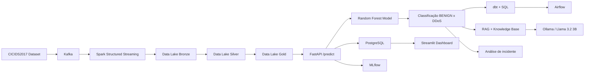

# Cyber Threat Intelligence Platform

## Plataforma inteligente de detecção de ameaças em tempo real com Machine Learning, Streaming, Data Engineering e IA Generativa.


Este projeto foi desenvolvido para demonstrar uma arquitetura completa de Cyber Threat Intelligence, combinando ingestão de dados em tempo real, processamento distribuído, modelagem preditiva, qualidade de dados, orquestração, visualização e análise de incidentes com RAG + LLM.

O objetivo principal é detectar tráfego malicioso, especialmente DDoS, com classificação automatizada e suporte à investigação com explicações em linguagem natural.


## Visão geral

A plataforma processa eventos de rede em tempo real, aplica um modelo de Machine Learning para classificar tráfego como BENIGN ou DDoS e registra cada predição em banco relacional. Em paralelo, o ecossistema de dados e analytics conecta o processamento em streaming, transformação em SQL com dbt, orquestração com Airflow, rastreio de experimentos com MLflow e análise contextualizada de incidentes com RAG e Ollama.

A solução foi pensada como um projeto de portfolio para AI Engineer / Machine Learning Engineer, com foco em:

- engenharia de dados
- pipeline de dados em tempo real
- modelagem preditiva
- qualidade de dados
- integração com APIs e banco de dados
- observabilidade e orquestração
- IA generativa aplicada à segurança


## Problema que o projeto resolve

O cenário de segurança cibernética exige análise rápida e confiável de tráfego de rede. Ataques DDoS podem causar indisponibilidade de serviços, perda de negócio e impacto operacional.

Este projeto resolve esse problema ao:

- capturar eventos de rede em fluxo
- padronizar e transformar dados em camadas analíticas
- classificar automaticamente tráfego em BENIGN ou DDoS
- persistir predições em banco de dados
- realizar análise de contexto do incidente em linguagem natural
- disponibilizar uma visão operacional em dashboard

A classificação é feita por um modelo de Machine Learning. O LLM não decide se existe ataque; ele explica o incidente e sugere ações com base na base de conhecimento.


## Arquitetura completa

A solução combina os principais componentes abaixo:

- CICIDS2017 como base de dados de referência
- Kafka para ingestão de eventos
- Spark Structured Streaming para processamento em tempo real
- Data Lake com camadas Bronze, Silver e Gold
- FastAPI para disponibilizar um endpoint de predição
- PostgreSQL para persistência de resultados
- SQL e dbt para transformação e qualidade de dados
- Airflow para orquestração
- MLflow para rastreamento de experimentos
- Streamlit para dashboard
- RAG + Ollama + Llama 3.2 3B para explicação de incidentes
- Docker e Docker Compose para execução local


## Diagrama Mermaid




## Dataset CICIDS2017

O projeto utiliza o conjunto CICIDS2017 como base de treinamento e validação para classificação de tráfego de rede.

Importante:

- CICIDS2017 representa tráfego coletado em ambiente controlado / laboratorial.
- não é tráfego real de produção.
- o dataset é usado como cenário de pesquisa e demonstração de engenharia de dados + ML para segurança.

A abordagem aqui é acadêmica/projeto de portfolio, com foco em arquitetura, pipeline e integração de componentes reais.


## Kafka

Kafka é utilizado como camada de ingestão e desacoplamento entre fontes de eventos e o processamento em streaming. O projeto foi estruturado para receber eventos de rede e encaminhar dados para processamento distribuído.


## Spark Structured Streaming

O Spark Structured Streaming faz o processamento contínuo dos dados recebidos, transformando a entrada em estruturas apropriadas para a camada de dados analíticos e para a análise de incidentes.


## Data Lake Bronze / Silver / Gold

A arquitetura do Data Lake foi organizada em camadas:

- Bronze: dados brutos e ingestão inicial
- Silver: dados limpos, normalizados e conformados
- Gold: dados prontos para análise analítica e consumo por modelos e dashboards

Essa estrutura ajuda a manter a rastreabilidade, a qualidade e a organização dos dados ao longo do pipeline.


## Machine Learning

O projeto usa Machine Learning para classificação binária de tráfego em:

- BENIGN
- DDoS

### Baseline: Logistic Regression

O modelo de baseline foi construído com Logistic Regression para estabelecer uma referência simples e interpretable durante a comparação de desempenho.

### Modelo final: Random Forest

O modelo final adotado foi Random Forest, por apresentar melhor capacidade de separar padrões de tráfego malicioso e benigno no conjunto CICIDS2017.

Além disso, a análise de redundância reduziu o conjunto de features de 68 para 64, eliminando variáveis com baixa contribuição ou excesso de redundância.

### Métricas finais do Random Forest

Validação:

- Accuracy = 0.9999402307094615
- Precision = 1.0
- Recall = 0.9998958441828976
- F1 = 0.999947919379199

Teste:

- Accuracy = 0.999880461418923
- Precision = 0.9999479166666667
- Recall = 0.9998437662743465
- F1 = 0.999895838758398

Esses resultados mostram um desempenho extremamente alto no cenário controlado do dataset, reforçando a capacidade do modelo de distinguir comportamento DDoS.


## FastAPI

O serviço API foi implementado em FastAPI com um endpoint principal:

- POST /predict

Ele recebe um dicionário de features do tráfego e retorna:

- prediction
- class
- probability_benign
- probability_ddos
- created_at
- incident_analysis em caso de DDoS

A API também persiste cada predição em PostgreSQL.


## PostgreSQL

O PostgreSQL armazena os resultados de predição em tabelas estruturadas. Esse componente permite:

- auditoria das inferências
- consulta histórica
- uso posterior em análises e dashboards
- suporte ao pipeline de dados analíticos


## SQL

A camada SQL foi usada para:

- modelar tabelas de staging
- preparar métricas e agregações
- alimentar consultas analíticas e relatórios
- servir como base para as views e modelos do dbt


## dbt

O projeto inclui um projeto dbt em `dbt_cyber/`, com estrutura correta e organizada:

- `dbt_project.yml`
- `profiles.yml`
- `models/`

A estrutura do dbt foi mantida na pasta `dbt_cyber/` conforme a organização real do projeto. O uso do dbt permite:

- padronizar modelos SQL
- criar camada de staging e marts
- validar qualidade de dados
- centralizar transformações analíticas

### 13 testes de Data Quality

O pipeline dbt implementa 13 testes de qualidade de dados, cobrindo validações como:

- not_null
- unique
- accepted_values
- integridade de colunas e métricas

Esses testes foram executados com sucesso no ambiente local, conforme evidência de logs da execução do dbt.


## Airflow

O Airflow orquestra os fluxos de dados e integra o contexto de pipelines e dbt com a arquitetura geral. O ambiente foi configurado para gerir a parte operacional do projeto e facilitar a execução e monitoramento de jobs.


## MLflow

O MLflow foi incluído para rastrear experimentos, metadados e artefatos relacionados ao treinamento e à evolução dos modelos. Essa camada melhora a reprodutibilidade e a gestão do ciclo de vida do modelo.


## Streamlit

O dashboard permite a visualização dos resultados e do comportamento do sistema, com foco em:

- análise de predições
- monitoring de classes previstas
- avaliação de ameaças e padrões
- dashboard operacional para observação do pipeline


## RAG

O módulo RAG permite recuperar contexto a partir de uma base de conhecimento e gerar respostas baseadas em documentação do domínio de segurança. O uso de recuperação + geração ajuda a transformar uma detecção técnica em explicação accionável.


## Ollama

O projeto integra a inferência local com Ollama, permitindo execução de modelos de linguagem localmente sem depender de API externa.


## Llama 3.2 3B

O modelo Llama 3.2 3B foi escolhido como motor de geração do assistente de incidentes. Sua função é explicar o evento e sugerir ações, sempre com base na knowledge base do sistema.


## Análise automática de incidentes DDoS

Quando a classificação do modelo identifica um incidente DDoS, o sistema chama a análise de incidente com RAG + LLM.

A lógica da aplicação é a seguinte:

- o Random Forest decide se o tráfego é BENIGN ou DDoS
- o modelo não substitui a decisão humana; ele fornece a classificação base
- o LLM interpreta o contexto do incidente e explica o cenário usando a knowledge base
- o sistema sugere ações recomendadas com base no conhecimento recuperado

Isso é um uso complementar de IA generativa: explicação e apoio analítico, não decisão primária de ataque.


## Docker / Docker Compose

A execução local foi organizada em containers para facilitar a reprodução do ambiente:

- PostgreSQL
- FastAPI
- Dashboard
- Kafka
- Spark
- Airflow

O projeto pode ser executado via Docker Compose, com orquestração centralizada em `docker-compose.yml`.


## Estrutura real do repositório

```text
.
├── app.py
├── Dockerfile
├── docker-compose.yml
├── requirements.txt
├── Cyber_Threat_Intelligence_Platform.ipynb
├── random_forest_ddos_model.pkl
├── model_features.pkl
├── CICIDS2017_DDoS.parquet
├── CICIDS2017_DDoS_Silver.parquet
├── sql/
│   └── init.sql
├── dbt_cyber/
│   ├── dbt_project.yml
│   ├── profiles.yml
│   └── models/
├── airflow/
│   ├── dags/
│   ├── Dockerfile
│   ├── plugins/
│   └── logs/
├── dashboard/
│   ├── app.py
│   └── Dockerfile
├── streaming/
├── data_lake/
├── rag/
│   ├── knowledge_base/
│   ├── rag_engine.py
│   └── incident_assistant.py
├── mlflow/
├── test_app.py
├── test_ddos_api.py
└── README.md
```

A estrutura foi respeitada conforme a organização real do projeto. O objetivo foi evitar qualquer movimento ou alteração de arquivos sem necessidade.


## Exemplo real de resposta da API

Abaixo está um exemplo real já obtido em execução do endpoint de predição:

```json
{
  "prediction_id": 661,
  "prediction": 1,
  "class": "DDoS",
  "probability_benign": 0.0,
  "probability_ddos": 1.0,
  "created_at": "2024-xx-xxTxx:xx:xx.xxxxxx",
  "knowledge_source": "ddos.md",
  "analysis": "O sistema identificou um incidente de DDoS com alta probabilidade. O impacto principal é a indisponibilidade de serviços. Recomenda-se reforçar proteção de rede, limitar tráfego malicioso e revisar logs de infraestrutura."
}
```

O campo `analysis` foi resumido para manter o README bem organizado e profissional, sem perder o valor do entendimento do fluxo.


## Como executar

### 1. Clonar o repositório

```bash
git clone <repositorio>
cd cyber-threat-intelligence-platform
```

### 2. Instalar dependências

```bash
pip install -r requirements.txt
```

### 3. Iniciar com Docker Compose

```bash
docker compose up -d
```

O tópico Kafka `network-traffic` é criado automaticamente durante a inicialização do ambiente. O Spark consumer também pode ser iniciado via Compose, sem necessidade de executar `kafka-topics.sh` manualmente ou montar `/tmp/.ivy2` manualmente.

### 4. Acessar os serviços

- API: http://localhost:8001
- Dashboard: http://localhost:8501
- Airflow: http://localhost:8080
- PostgreSQL: localhost:5433

### 5. Iniciar o consumer do Spark

```bash
docker compose up -d spark-consumer
```

### 6. Testar a API

```bash
python test_ddos_api.py
```


## Limitações

- O dataset CICIDS2017 é de laboratório e não representa tráfego real de produção.
- O projeto atualmente realiza classificação binária BENIGN x DDoS.
- O foco desta solução é demonstrar arquitetura e integração de pipeline, não um sistema totalmente pronto para produção industrial.
- O LLM é usado para explicação e suporte de decisão, e não substitui a classificação do modelo de Machine Learning.
- A análise de incidentes depende do conhecimento disponível na base local e da execução correta de Ollama.


## Próximos passos

- ampliar a base de conhecimento para diferentes tipos de ameaças
- integrar fontes de logs reais em produção
- evoluir para classificação multi-classe
- conectar o projeto com alertas e detecção real-time mais robusta
- melhorar dashboards e métricas operacionais
- expandir rastreio de experimentos e versionamento do modelo
- adicionar pipelines de monitoramento e alertas automatizados


## Conclusão

Este projeto demonstra uma arquitetura completa de Cyber Threat Intelligence aplicada ao problema de DDoS detection, unindo dados, modelagem preditiva, engenharia de dados, governança analítica, orquestração e IA generativa em um único ecossistema.

Ele foi estruturado para ser um portfólio profissional de AI Engineer / Machine Learning Engineer, mostrando não apenas a modelagem, mas também a construção de um pipeline end-to-end em tempo real.

